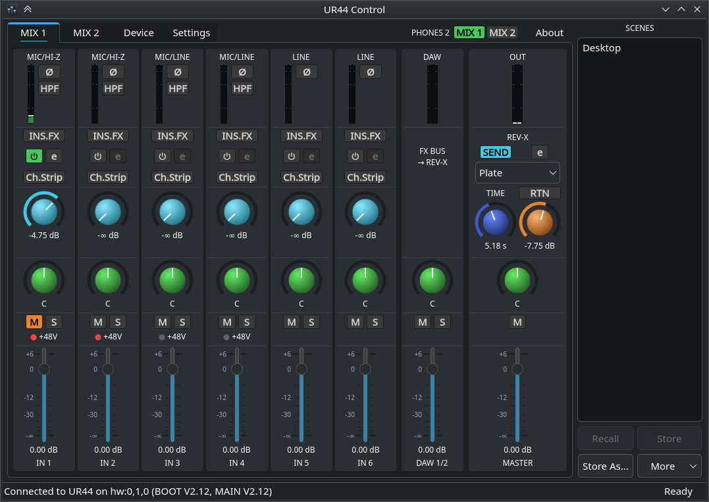
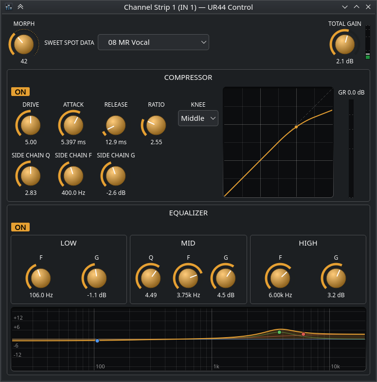
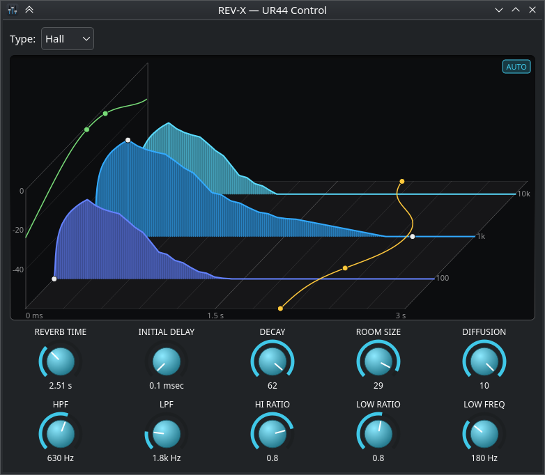

# UR-44

Linux (and eventually cross-platform) control of the **Steinberg UR44** USB audio interface's
internal DSP mixer: the settings dspMixFx manages on Windows/macOS.

Both class-compliant and non-class-compliant modes of the device are supported.



## The GUI

The main window is partially implemented:

* The main mix area has all the controls of the original, including linking input pairs as stereo pairs.
* The right panel allows saving and applying any number of 'Scenes' - the full mixer and effects state.
  * Import and export of original dspMixFx scene files (.UR44) is also there, but needs testing.

The effect editors are also implemented, including their graph representation:

* REV-X and Channel Strip effects are at parity with the original software
  * You can drag the EQ's points and the REV-X graph's handles to set the parameters.
* Guitar effects still need some UI work and verification, but all the controls are there.

It finds the UR44 by its ALSA card name and owns the second MIDI port while it runs, so close it before using
any other tool (like `tools/ur44.py`) that wants to interact with the device configuration.

| Sweet Spot Morphing Channel Strip | REV-X |
|---|---|
|  |  |

### Building
It needs Qt 6, CMake 3.16+, the ALSA development files and Python 3 (for the build-time generators).

```bash
cmake -B build
cmake --build build
ctest --test-dir build
build/gui/src/application/ur44-control
```

### Installation
Installing (e.g. for a distribution package) uses the standard CMake and GNU directory variables:

```bash
cmake -B build -DCMAKE_BUILD_TYPE=Release -DCMAKE_INSTALL_PREFIX=/usr -DBUILD_TESTING=OFF
cmake --build build
DESTDIR="$pkgdir" cmake --install build
```

`BUILD_TESTING=OFF` skips the tests and the Qt Test dependency.

## CLI tools

```bash
python3 tools/ur44.py version          # ['BOOT', 'V2.12', 'MAIN', 'V2.12']
python3 tools/ur44.py mix 2            # show MIX 2 routing in dB / L-C-R
python3 tools/ur44.py set ChSendMixBus2Level 0 103   # input 1 -> MIX 2 at 0.00 dB
python3 tools/ur44.py phones2 2        # PHONES 2 listens to MIX 2
python3 tools/ur44.py monitor          # watch unsolicited changes (e.g. +48V switches)
```

The control port is found automatically: `hw:N,0,1` in Class Compliant mode (USB id 0499:1704), `hw:N,1,0` with
the [CC MODE] switch off (0499:150e). Override it with `--port`.

## Layout

| Path | Contents |
|---|---|
| `tools/` | CLI for interaction with the device. Main is `ur44.py`: `version`, `get`, `set`, `dump`, `mix 1\|2`, `phones2`, `monitor` |
| `gui/` | **UR44 Control**, the Qt 6 mixer application (C++17, CMake). See [gui/README.md](gui/README.md) for details |
| `docs/` | Documentation about the protocol and reverse engineering notes |
| `re/` | Reproducible RE scripts: vendor extraction, generators, Ghidra runner, finders, sweep |
| `vendor/` | (git-ignored) download cache, unpacked downloads, extracted binaries, decompilations |


## Rebuilding the generated files

```bash
re/download_vendor.py                                    # TOOLS V2.2.2 + firmware updater (pinned SHA-256)
re/download_vendor.py --only V2111 --accept-yamaha-license   # driver V2.1.11, behind Yamaha's license page
re/download_vendor.py --group extra                      # optional: driver V2.1.7, macOS updater, macOS TOOLS V2.3.0
re/extract_vendor.sh
python3 -I re/gen_params.py vendor/extracted/tools_v222/dspmixfx_x86/memapi_ur44.dll
python3 -I re/dump_memapi_labels.py vendor/extracted/tools_v222/dspmixfx_x86/memapi_ur44.dll > tools/ur44_labels.json
re/ghidra/decompile_all.sh                               # optional, slow
```

## License

The code is under the [Microsoft Public License (Ms-PL)](LICENSE).

Not covered by it: the 34 Sweet Spot Data presets in `tools/ur44_sweet_spot.py` (and built into the GUI from it)
come with Yamaha/Steinberg's TOOLS for UR44 and carry their notice, "Copyright(C)2008 Yamaha Corporation All Right
Reserved". The UR44's control protocol was reverse engineered from TOOLS for UR44 for interoperability; this project
isn't affiliated with or endorsed by Yamaha or Steinberg.
